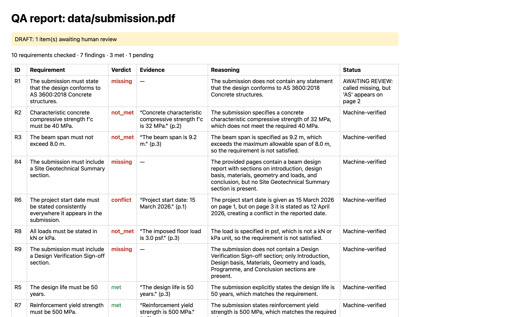

# PDF Compare QA

Checks an engineering submission PDF against a checklist of requirements, cites its evidence, and routes anything doubtful to a human reviewer. Built as a demo of an AI document-QA workflow. All documents are fictional.



## How it works

```
PDF -> extract pages -> retrieve relevant pages per requirement
    -> LLM returns structured verdict + exact quote + page
    -> verify in code -> human review of flagged items -> HTML report
```

1. **Extract** (PyMuPDF): text per page with page numbers; pages with no text are flagged for OCR.
2. **Retrieve**: keyword scoring picks the pages each requirement needs. Presence and consistency checks get the whole document, so a "missing section" verdict can't be caused by a retrieval miss.
3. **Check**: one LLM call per requirement through an OpenAI-compatible API, temperature 0, JSON-only output validated with pydantic. Bad JSON is retried with a correction message, then recorded as `failed` and never guessed.
4. **Verify** (plain code, not the LLM):
   - the quoted evidence must appear on the cited page
   - numbers and units are compared in code
   - a "missing" verdict is flagged if the requirement's keywords appear in the document
   - failed output and low confidence are flagged
5. **Review**: flagged items wait for a person (accept or override). The report records who decided, and an unreviewed report is stamped DRAFT.
6. **Report**: HTML with verdict, quote, page, reasoning and review status.

Page text is passed as delimited data and the system prompt tells the model to ignore instructions inside it (tested).

## Run it

```bash
python3 -m venv .venv && source .venv/bin/activate
pip install -r requirements.txt
cp .env.example .env            # add your key
python scripts/make_pdfs.py     # fictional spec + submission, 7 planted problems
python -m app.run --reviewer "Your Name"
pytest -q                       # 21 tests, LLM mocked
python -m scripts.eval --runs 1
```

Switch models or providers by changing three variables in `.env` (`LLM_BASE_URL`, `LLM_API_KEY`, `LLM_MODEL`). Tested with OpenRouter's free tier; Gemini's OpenAI-compatible endpoint also works.

## Evaluation

Ten requirements against a fictional submission with 7 planted problems (wrong values, wrong standard, wrong unit, two missing sections, one date conflict) and 3 correct controls.

| model | runs | detected | false alarms | exact verdicts | silent errors | sent to review |
|---|---|---|---|---|---|---|
| cohere/north-mini-code:free | 1 | 7/7 | 0/3 | 9/10 | 0 | 1 |

*Silent error = wrong verdict approved with no human review.*

The one wrong verdict (R1, labelled `missing` instead of `not_met`, ignoring the AS 4100 citation on page 2) was caught by the verifier and sent to review.

**Caveats:** one run replayed from cache, one small model, ten requirements on one synthetic document. This shows the design works, not general accuracy. [Add multi-run and second-provider rows here when run.]

## Limits

- No OCR yet (scanned pages are flagged, not read)
- Keyword retrieval misses synonyms; embeddings would help at scale
- The numeric parser takes the first matching number in a quote
- The reviewer sees the quote, not the page image
- Command-line only, not deployed

## Next steps

OCR for scans, embedding retrieval, a requirements extractor that builds the checklist from a spec PDF, a web review screen, and intake from SharePoint with Teams notifications.

## Layout

`app/` pipeline (extract, retrieve, check, verify, review, report) · `scripts/` test-document generator and eval · `tests/` · `data/` fictional PDFs, checklist and answer key